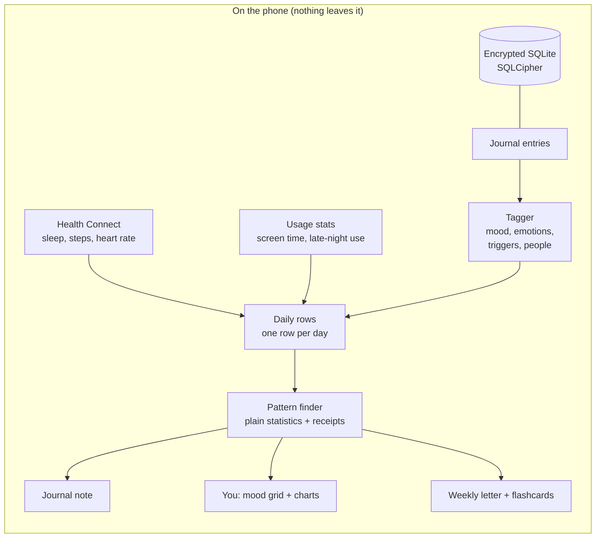

# Cicada

**A private journal that notices the patterns behind how you feel.**

You write a normal journal. Cicada reads your entries next to your sleep, steps and screen time, all on your phone, and tells you what it finds: "After nights under six hours, your entries were rougher 9 of 10 times." No chatbot, no therapist act, nothing sent to a server.

Built for **wHACKiest 2026, Track 3: Know Thyself** (personal data, AI insights, privacy first).

---

## The problem

- People journal, close the app, and learn nothing. The entries pile up unread.
- Phones and watches record sleep, steps and screen time, but that data never meets the story of the day.
- AI journals turn writing into a chat with a pseudo-therapist. Many people just want to write.
- What you write in a journal is about the most sensitive data there is. Sending it to a cloud model is a real cost.

## What Cicada does

| | |
|---|---|
| **Write** | A plain journal: title, text, done. No prompts. If you're stuck, ✦ Ideas offers three things to write about, drawn from what Cicada has learned ("You haven't written about Meera since Friday"). |
| **One-tap mood** | Optional, on save. Skip is always there. |
| **Quiet tagging** | Each entry becomes structured tags on the phone: mood, energy, emotions, triggers, people. |
| **Signals** | Sleep, steps and heart rate from Health Connect; screen time from Android's usage stats. Works with just a phone; a watch adds more. |
| **Patterns** | Plain statistics link what you wrote to what your body and phone did. Only solid patterns speak. |
| **Journal note** | At most one quiet note on the journal screen: "You wrote angrier on the 3 days after sleeping under six hours." |
| **You** | Your month's mood at a glance, and one chart per pattern. Every chart answers something. |
| **Weekly letter** | A short letter about last week, one experiment to try, then every pattern as a flashcard with its receipts: the exact days and entries behind it. |
| **Learning period** | Until there's enough data, Cicada says it's still learning, and claims nothing. |

### Principles
- **Insights, not a therapist.** Cicada never chats and never asks on its own.
- **Patterns, never diagnoses.** It talks about days and habits, not disorders. It never blames a person: people only appear in good patterns.
- **Receipts for everything.** Every claim links to the days behind it, with how often it held.
- **On the device.** Entries live in an encrypted database on the phone.
- **Calm by default.** A journal first. Depth only when you tap for it.

---

## How it works



**The model is small on purpose.** Raw data never goes into a language model. Code squashes each day into one row (hours slept, steps, minutes on the phone after midnight, the day's tags), and ordinary statistics find the patterns. A small on-device model only does two narrow jobs: tag each entry, and later rephrase the letter. So adding a data source adds a column, not load on the model, and every sentence in the letter is backed by numbers.

### When a pattern is allowed to speak
A pattern is shown only if all of these hold:
- at least 3 days on each side of the comparison,
- a clear gap in mood (0.8 or more on a −2 to +2 scale),
- it held on at least two thirds of its days,
- and it's strong enough overall (a 2-of-3 pattern is filtered out).

| Pattern | Compares | Example |
|---|---|---|
| Short nights | mood after nights under 6 h vs the rest | "After nights under six hours, your entries were rougher 9 of 10 times." |
| Late scrolling | sleep after over 1 h of phone use past midnight | "You slept 4 h 51 m, against 7 h 13 m otherwise." |
| Active days | mood on days over 9,000 steps | "Calmer and brighter 7 of 7 times." |
| People | mood in entries that mention someone (good only) | "Entries that mention Meera were among your best." |
| Triggers | mood in entries about a trigger | "When you wrote about deadlines and exams, the entry was tense 6 of 6 times." |

---

## Status (round 1)

Honest about what runs today:

| Piece | Status |
|---|---|
| Journal, writing, ideas, one-tap mood | ✅ Built, running on an Android phone |
| Encrypted local database (SQLCipher, key in the phone's secure storage) | ✅ Built |
| Pattern finder with receipts | ✅ Built, unit-tested |
| You screen: mood grid, pattern charts | ✅ Built |
| Weekly letter and flashcards | ✅ Built |
| Sample month (35 days, clearly marked) so the demo shows real patterns | ✅ Built |
| On-device tagger (small LLM via `llama.rn`) | 🔜 Next. Sample entries come pre-tagged. |
| Health Connect and screen-time readers | 🔜 Next. Sample signals stand in, behind the same interface. |
| "Not true for me" teaching the finder | Saved, not used yet |
| Timely nudges, app lock, export and delete | Planned |

---

## Run it

Android only for now (Health Connect is Android). Needs Node 20+, JDK 17 and the Android SDK. It uses native modules, so it runs as a development build, not in Expo Go.

```bash
npm install
npx expo run:android      # builds and installs the app
npm start                 # dev server on port 8083
```

On first launch Cicada fills itself with a sample month (a made-up student's journal and phone data) so the patterns have something to show.

**Checks**
```bash
npm test             # 44 unit tests: sample data, pattern finder, letter, grid, charts
npm run typecheck
npm run lint
```

> Windows note: Reanimated and Gesture Handler build objects at very long paths. If the native build fails with `ninja: error: mkdir(...)`, use ninja 1.12 or newer in the Android SDK's CMake (the bundled 1.10 ignores Windows long paths).

## Project layout

```
src/
  app/            screens (Expo Router): journal, you, write, report
  components/     journal/, write/, you/, report/ and shared pieces
  data/           store interface, encrypted SQLite store, sample month
  domain/         types (Entry, Tags, DaySignals), dates, journal sections
  insights/       daily rows, pattern finder, week note, letter, ideas, charts
  theme/          design tokens, motion curves, reduce-motion
```

## Stack
Expo SDK 58, React Native, TypeScript, Expo Router, Reanimated, react-native-svg, expo-sqlite with SQLCipher, expo-secure-store, Jest.

Code comments mention design decisions by number (e.g. "Decision 0009"). Those live in the team's design notes.
